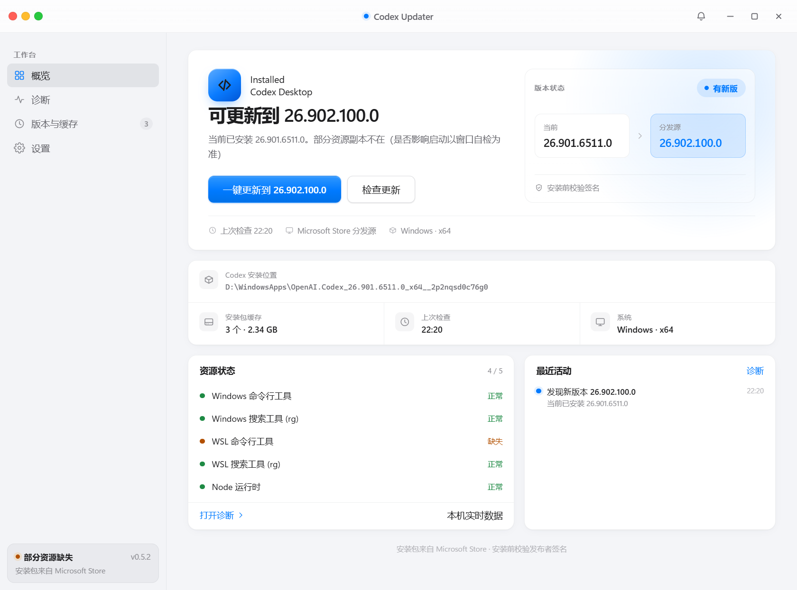
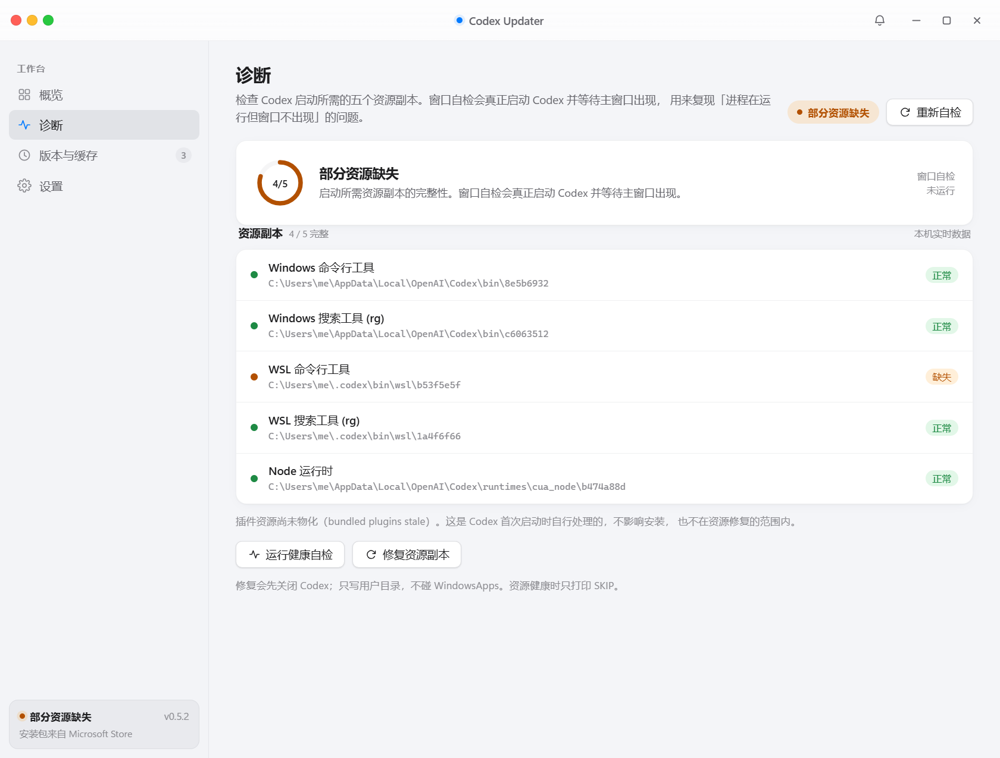
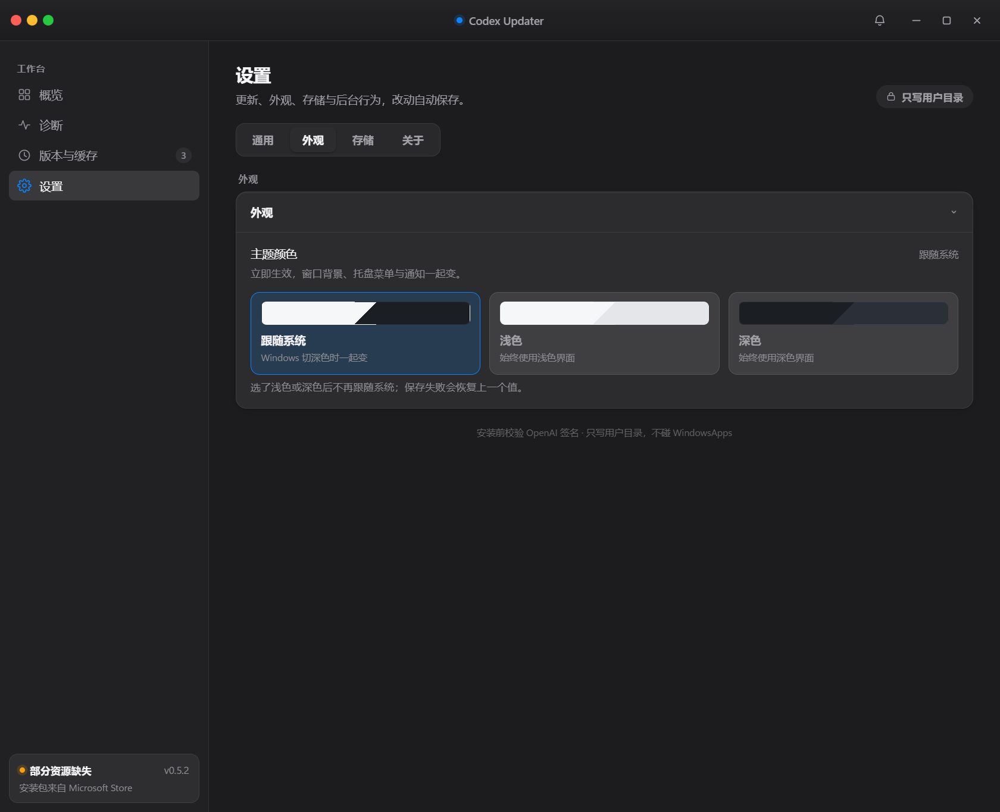
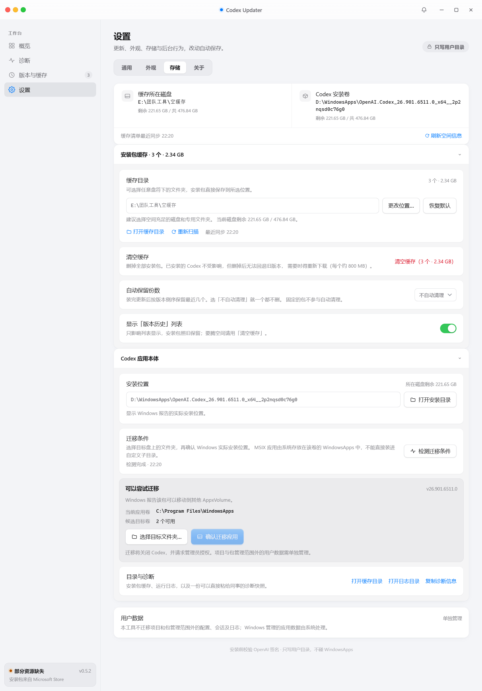
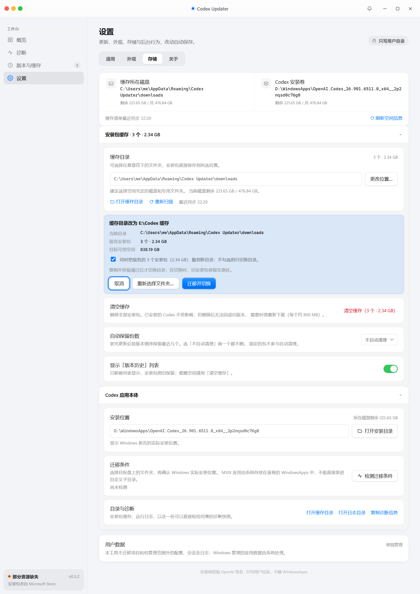

# Codex Updater

[](https://github.com/aygzs123/Codex-Auto-Update-Plugin-New/actions/workflows/ci.yml)
[](./LICENSE)
[English](README_EN.md) | [中文](README.md)

在 Windows 上把 **Microsoft Store / MSIX 版 Codex Desktop** 更新到最新版，
并处理它更新过程中会遇到的几个坑：需要管理员权限的安装包、更新后窗口不出现、
更新完想退回上一版。

**桌面端 0.5.2**：缓存直接保存到自选文件夹；应用迁移增加文件夹选择与实际位置确认，
并修复空缓存切换、迁移文件保护和取消授权提示。
[下载 0.5.2](https://github.com/aygzs123/Codex-Auto-Update-Plugin-New/releases/tag/desktop-v0.5.2)
· [更新公告](desktop/CHANGELOG.md)



| 诊断与常驻修复 | 深色设置 |
| --- | --- |
|  |  |

| 存储管理（缓存 / 应用本体 / 用户数据分开说明） | 缓存迁移确认 |
| --- | --- |
|  |  |

> 截图来自 `desktop/scripts/verify-render.cjs` 的真实构建产物，使用桩数据渲染，
> 不读取也不修改本机真实缓存。

## 这是什么

它解决一个问题：**Codex Desktop 的商店版更新，在无人值守或新机器场景下不好使。**
商店自己更新不了的时候没有任何提示，新版还需要管理员上下文才能装，装完偶尔还会
「进程在跑但窗口不出现」。这个仓库把这几件事做成了一条能一键走完、且每一步都有
证据的链路。

三个入口，按「谁该用」挑一个就行：

| 入口 | 形态 | 谁该用 |
| --- | --- | --- |
| **桌面应用** | 单个自包含的 NSIS `.exe` | 大多数用户；新机器；不想碰命令行；要诊断和回退 |
| **插件 + 每日自动化** | `install\install.ps1` | 已经在用 Codex 插件体系，要无人值守每日检查 |
| **Web 界面** | 克隆仓库后跑 `webui\start-webui.bat` | 已克隆仓库，想要按钮 + 实时日志（需要 Python 3） |

**三者不协作，选一个即可。** 桌面应用把同一批 PowerShell 脚本
（`npm run sync:scripts` → `extraResources`）**复制进自己的安装包**，所以它
**既不读也不改** `%USERPROFILE%\.codex` 下的插件，机器上没装过插件也能用。
插件和 Web 界面才共用仓库里那份脚本（Web 界面调用的正是插件里那几个脚本）。

## 环境要求

- **Windows 10 / 11**，x64。
- **Codex Desktop 必须是 Windows 已注册的 Microsoft Store / MSIX 版**。是否适用取决于
  包类型与注册状态，而不是下载来源；便携版或其他非 MSIX 安装方式不在支持范围内。
- **Windows PowerShell 5.1**（`powershell.exe`）。仓库里的脚本刻意不支持
  PowerShell 7 / `pwsh`，原因见[三个必须遵守的实现约束](#三个必须遵守的实现约束)。
- Web 界面需要 **Python 3**；从源码跑桌面应用需要 **Node 22**。用 exe 的话两者都不需要。

## 快速开始

### 桌面应用（推荐）

从 [Releases](https://github.com/aygzs123/Codex-Auto-Update-Plugin-New/releases)
下载最新的 `Codex Updater Setup x.y.z.exe`，双击即可 —— 当前用户安装，不需要管理员
权限。打开后点主按钮，查更新 → 下载 → 签名校验 → 安装 → 启动探测整条链一次走完。

> 构建**未做代码签名**，首次运行会看到 SmartScreen 的「Windows 已保护你的电脑」，
> 点「更多信息 → 仍要运行」即可。

### 装进本机 Codex

在**仓库根目录**执行：

```powershell
powershell -NoProfile -ExecutionPolicy Bypass -File install\install.ps1
```

它把 `plugins\codex-ms-desktop-updater` 复制到
`%USERPROFILE%\.codex\plugins\codex-ms-desktop-updater`（**跳过** `downloads` 缓存），
并按 `install\automation.toml` 模板生成每日自动化
（`%USERPROFILE%\.codex\automations\daily-codex-desktop-update-check\automation.toml`）。
模板靠 `{{CODEX_PLUGIN_ROOT}}`、`{{CODEX_MAINTENANCE_SCRIPT}}` 两个占位符保持可迁移，
不含盘符硬编码（细节见 [`AGENTS.md`](AGENTS.md)）。

**安装后如果插件没有立即出现，重启 Codex Desktop 即可。**

<details>
<summary>不使用 install.ps1 的手动复制方式</summary>

把插件目录复制到 `%USERPROFILE%\.codex\plugins\codex-ms-desktop-updater`，然后在
`%USERPROFILE%\.codex\.agents\plugins\marketplace.json` 里登记：

```json
{
  "policy": { "installation": "AVAILABLE", "authentication": "ON_INSTALL" },
  "category": "Developer Tools",
  "name": "codex-ms-desktop-updater",
  "source": { "path": "./plugins/codex-ms-desktop-updater", "source": "local" }
}
```

</details>

## 特性

- **更新检查**：查 `https://store.rg-adguard.net/api/GetFiles` 获取 Codex 商店条目
  (`9plm9xgg6vks`) 的包链接，解析 `OpenAI.Codex_*.msix` / bundle。
- **按需下载与安装**：只有 `-DownloadOnly` / `-Install` / `-InstallWithRestart` 才下载；
  只有 `-Install` / `-InstallWithRestart` 才执行 `Add-AppxPackage`。
- **安装后重启**：`-InstallWithRestart` 起一个独立流程 —— 关闭 Codex、安装 MSIX、
  校验已装版本不低于下载版本、再重启 Codex。
- **需要时提权**：新版清单声明了以 `localSystem` 运行的打包服务，Windows 因此要求管理员
  上下文（否则报 `0x80073D28`）。脚本会先读安装包清单判断，只在真的需要时弹**一次** UAC；
  默认**关闭**，没有 `-AllowElevation` 就如实拒绝（见[常见问题](#常见问题)）。
- **保缓存 + 版本回退**：缓存保留最近 2 个 Codex 安装包（约 1.67 GB）供回退；桌面应用默认
  一个都不删、由用户决定保留几份或何时清空，版本历史里还能逐个固定、校验签名、删除
  （见 [`docs/rollback.md`](docs/rollback.md)）。缓存直接使用所选文件夹，不追加固定子目录；
  旧安装包要不要一起搬在确认块里勾选，复制并校验 SHA-256 后才切换设置。
  提交前失败或取消保留源目录与设置；提交后取消仅停止后续清理，变化的源文件不会被删除。
- **插件自更新**：对比本机与远端 `plugin.json` 版本，自动从 GitHub 更新插件。
- **更新器自身更新（桌面应用）**：「设置 → 关于」直接检查本仓库的 `desktop-v*` Release，
  发现新版本后在应用内下载（失败自动重试、断点续传，界面显示大小 / 速度 / 剩余时间）、
  按 GitHub 给出的 SHA-256 校验再静默安装，装完自动重启。
- **桌面端设置**：设置按「通用 / 外观 / 存储 / 关于」四类组织。通用是更新与通知
  （自动检查 / 自动下载 / 通知 / 复查间隔）与网络诊断（三条路径的连通性与代理规则）；
  外观是主题颜色（跟随系统 / 浅色 / 深色，立即生效并写进设置）；存储给出真实磁盘剩余，
  并分别处理安装包缓存、Codex 应用本体与用户数据。
- **存储管理（桌面应用）**：缓存可选盘符和文件夹，空缓存也能更换位置。Codex 应用本体先
  检测迁移条件，再选择目标文件夹；界面同时展示所选路径和对应的 Windows 应用存储位置。
  确认后通过 `Move-AppxPackage` 迁移到已挂载的应用卷，不能装进任意子文件夹。
  本工具不迁移项目和包管理范围外的配置、会话、日志；系统管理的应用数据由 Windows 处理。
- **更新公告**：以 [`desktop/CHANGELOG.md`](desktop/CHANGELOG.md) 为唯一来源 —— 应用内铃铛
  按版本倒序列出每版改了什么（版本、日期、条目），不出现发布平台术语，也不放外链；见
  [`desktop/README.md`](desktop/README.md#应用自身更新与公告)。
- **Web 界面**：本地可视化操作，按钮即命令，日志 SSE 实时滚动。
- **健康自检 + 窗口探测**：检测「进程在跑但主窗口不出现」，并按证据给出判定
  （还在准备 / 官方加密资源搬迁 bug / 判不出来），三档里只有搬迁 bug 那一档才提示修复。

## 用法

### 桌面应用

打开即自检，主区那行大字直接给结论（「已是最新版：X」/「可更新到 Y」）。诊断是做实了的：
健康自检逐项列出 5 个资源组件（win-cli / win-rg / wsl-cli / wsl-rg / cua_node）的实际状态
与路径，启动探测能识别「进程在跑但没有主窗口」这个官方 bug 并给出修复入口，签名校验不通过
会**中止安装**。

「安装包缓存」卡片显示缓存里有几个包、共占多少，旁边就是「打开缓存目录」和「清空缓存」
—— 安装包保存在这里，运行日志可从“打开日志目录”查看。换目录时直接使用所选文件夹，
可勾选是否搬迁已有安装包；空缓存也需要确认，取消不会修改设置。
「版本历史」卡片给回退入口，对不需要它的人可以关掉显示（只隐藏卡片，不改任何行为）。
设置 → 存储中的「Codex 应用本体」先检测，再通过文件夹选择器确定目标卷；MSIX 实际由
Windows 存放到该应用卷的 WindowsApps 下，确认框会展示这一位置。项目和包管理范围外的
用户数据需单独管理，本工具没有“迁移全部用户数据”入口。
「关窗后留在托盘里」和「开机自动启动」是**可选项、默认关闭**，打开后也只是起来查一次、
发现新版本弹一条系统通知，**绝不自动安装** —— 需要管理员授权的安装永远由人点。
更新器自己也有更新入口（设置 → 关于），但它只更新这个安装工具，和上面的 Codex 更新是两条链路。

界面行为（单实例锁、窗口位置记忆、任务栏进度、深浅色、启动即查一次）与设计取舍见
[`desktop/README.md`](desktop/README.md) 与 [`docs/design-notes.md`](docs/design-notes.md)。

### 命令行速查

所有命令都在**仓库根目录**执行，使用 PowerShell。

| 目的 | 命令 |
|------|------|
| 仅检查是否有新版 | `check-codex-update.ps1 -CheckOnly` |
| 仅下载 | `check-codex-update.ps1 -DownloadOnly` |
| 下载并安装(不重启) | `check-codex-update.ps1 -Install` |
| 下载 → 关闭 → 安装 → 重启 | `check-codex-update.ps1 -InstallWithRestart -NoProxy` |
| 同上,并允许弹一次 UAC | `check-codex-update.ps1 -InstallWithRestart -NoProxy -AllowElevation` |
| 强制下载最新包(即使已装) | `download-latest-codex-msix.ps1 -NoProxy` |
| 安装已下载的 MSIX 并重启 | `install-codex-msix-and-restart.ps1 -PackagePath "<路径>"` |
| 回退到上一版(需留在缓存里) | `install-codex-msix-and-restart.ps1 -PackagePath "<路径>" -AllowDowngrade -AllowElevation` |

上面每条都省略了 `plugins\codex-ms-desktop-updater\scripts\` 前缀，实际执行时补上，
即 `powershell -NoProfile -ExecutionPolicy Bypass -File <脚本路径> <参数>`。

**参数说明**

- `-AllowElevation` **只在 `-InstallWithRestart` 这条路上存在**（`-CheckOnly` /
  `-DownloadOnly` / `-Install` 没有），`install-codex-msix-and-restart.ps1` 也直接接受它。
  不提权时遇到需要提权的包，不会失败在 `0x80073D28` 上，而是在碰 Codex 之前就报
  `ADMIN_PRIVILEGES_REQUIRED`。
- `-NoProxy` 被这三个脚本接受：`run-automatic-maintenance.ps1`、
  `update-installed-plugin.ps1`、`download-latest-codex-msix.ps1`。

**自动维护（插件自更新 + Codex 更新）**：

```powershell
powershell -NoProfile -ExecutionPolicy Bypass -File plugins\codex-ms-desktop-updater\scripts\run-automatic-maintenance.ps1 -NoProxy
```

**它不会请求管理员权限。** 无人值守的流程不能挂在一个 UAC 弹窗上，所以遇到需要提权的
版本时，它打印 `ADMIN_PRIVILEGES_REQUIRED`、写明「安装包已下载好、什么都没改动」，
然后**不启动**安装流程。这种版本请走桌面应用或上面那条带 `-AllowElevation` 的手动命令。

下载的安装包保存在 `plugins\codex-ms-desktop-updater\downloads\`（已被 `.gitignore` 忽略）。

### 版本回退

更新完发现新版本有问题时，桌面应用的「版本历史」卡片给「回退到此版本」按钮；
插件侧用 `list-cached-codex-packages.ps1 -DownloadDirectory "<缓存目录>"` 先看缓存里有什么。
两条保留策略（自动化剪枝留 2 个 / 桌面应用一个不删）、回退的三个实现要点与
**已知限制**见 [`docs/rollback.md`](docs/rollback.md)。

### 健康自检与窗口探测

```powershell
# 只读体检：各搬迁 bundle 是否存在 / 是否残留 .staging-*
powershell -NoProfile -ExecutionPolicy Bypass -File plugins\codex-ms-desktop-updater\scripts\check-codex-desktop-health.ps1

# 自检后启动 App 并等待主窗口（复现「进程在、无窗口」）
powershell -NoProfile -ExecutionPolicy Bypass -File plugins\codex-ms-desktop-updater\scripts\check-codex-desktop-health.ps1 -Probe -ProbeSeconds 25
```

退出码：`0` 健康 / `1` 组件缺失或降级 / `2` 未安装 / `3` 探测超时未出现主窗口。

`-InstallWithRestart` 安装后也会自动探测窗口；若未出现主窗口，安装日志会写
`WINDOW_PROBE=FAILED`、一行 `STARTUP_DIAGNOSIS=` 判定与可见顶层窗口清单。判定分三档：
`still-preparing`（还在物化运行时，稍等即可）、`relocation-bug`（确为搬迁问题）、
`unknown`（现有证据判不出来）。**只有 `relocation-bug` 那一档**日志才会给出修复脚本
那一行 —— 首次启动要物化几百 MB 运行时（实测约 132 秒），30 秒探针没等到窗口不代表出
问题了；拿到「最近仍有写入」的证据时探针会自动延长（最多再等 150 秒）。

修复脚本（需先退出 Codex）：

```powershell
powershell -NoProfile -ExecutionPolicy Bypass -File docs\codex-desktop-encrypted-copy-fix\repair-codex-desktop-bundles.ps1
```

> 安全边界：脚本只写 `%LOCALAPPDATA%\OpenAI\Codex` 与 `%USERPROFILE%\.codex`，
> **绝不改动** `C:\Program Files\WindowsApps` 下的文件 / ACL / 所有权。每次重跑对已健康的
> 缓存输出 `SKIP`，按当前安装版本动态计算 Bundle ID，可跨版本重复使用。

### Web 界面

双击 `webui\start-webui.bat`，它会检测本机 Python（`py` → `python` → `python3`）、
在后台启动 `server.py`、打开浏览器。顶部三张状态卡（已安装版本 / 运行进程数与主窗口 /
插件本地版本），日志经 SSE 实时滚动。

| 按钮 | 对应脚本 |
|------|----------|
| 🔍 检查 Codex 更新 | `check-codex-update.ps1 -CheckOnly -NoProxy` |
| ⬇️ 下载并安装 + 重启 | `check-codex-update.ps1 -InstallWithRestart -NoProxy` |
| 📦 检查插件更新 | `update-installed-plugin.ps1 -CheckOnly -NoProxy` |
| 🔄 更新插件 | `update-installed-plugin.ps1 -NoProxy` |
| 🩺 健康自检 | `check-codex-desktop-health.ps1` |
| 🚀 健康自检 + 启动探测 | `check-codex-desktop-health.ps1 -Probe` |

> 安全说明：服务只绑定 `127.0.0.1`，局域网 / 公网不可访问。按钮只触发项目内预定义脚本
> 与固定参数，不接受任意命令，不引入新的任意命令执行面。

## 常见问题

**Q：报 `HRESULT: 0x80073D28` 是什么？**
新版 Codex 的清单声明了一个以 `localSystem` 运行的打包服务，Windows 因此要求管理员上下文
才能 `Add-AppxPackage`。用桌面应用点更新，或跑带 `-AllowElevation` 的手动命令，会弹一次 UAC。

**Q：它要管理员权限，我点了「否」会怎样？**
什么都没改动、Codex 也不会被关闭。UAC 被取消只会让提权子进程起不来，worker 以一条说明
原因的 FATAL 收场，界面不会卡在「正在安装」。不提权时遇到需要提权的包，报的是
`ADMIN_PRIVILEGES_REQUIRED`（不是 `0x80073D28`）—— 那是脚本主动拒绝，不是失败。

**Q：更新之后 Codex 进程在跑，但窗口一直不出现。**
跑一次带 `-Probe` 的健康自检，看 `STARTUP_DIAGNOSIS=` 的判定。只有 `relocation-bug`
才需要动手：退出 Codex，跑上面的修复脚本。`still-preparing` 是首次启动在物化运行时，
等一会儿即可。

**Q：Codex 能装到我指定的盘吗？**
安装那一刻不行：MSIX 应用落在哪个卷由 Windows 的部署服务决定，安装器说了不算。桌面应用做了三件事：
把 `Get-AppxPackage` 报回来的**真实路径原样显示**、给一个「打开安装目录」按钮，以及在
「设置 → 存储 → Codex 应用本体」里提供**条件检测 + 迁移**：只有 Windows 已识别另一个
AppxVolume、且包本身允许移动时，才在用户确认后调用 `Move-AppxPackage` 迁移。
迁移不会复制 WindowsApps、不会改所有权、不会建目录联接，也不需要重装；结果以部署服务
回读的真实安装位置为准。配置、会话、日志与项目目录不随应用迁移。
改 Windows 的默认保存盘仍可走「设置 → 系统 → 存储 → 高级存储设置 → 新的应用将保存到」。

**Q：Codex 装在 D 盘还识别得到吗？**
识别得到。包通过 `Get-AppxPackage -Name OpenAI.Codex` 跨所有卷枚举，安装位置、进程归属、
`AppUserModelId` 全是现取现用，没有任何一处按 `C:\Program Files\WindowsApps` 拼路径。
这条不变量有回归测试逐行扫描代码钉住。

**Q：必须用商店版 Codex 吗？**
是。更新链路依赖商店条目，非商店版没有对应条目，查不到任何东西。

**Q：怎么回退到上一版？**
桌面应用的「版本历史」卡片里点「回退到此版本」，或跑带 `-AllowDowngrade` 的
`install-codex-msix-and-restart.ps1`。前提是那个安装包还在缓存里。

**Q：能退到我装这个工具之前的那一版吗？**
不能。回退只依赖本工具自己留下来的安装包，而更早的包在旧策略下已经被删掉了，
分发源只提供最新版、下不回来。功能要等**带着新策略更新过一次**之后才第一次可用。
界面上的空列表给的也是这段解释。

**Q：`downloads` 缓存一直涨。**
两条策略分别管：每日自动化保留最近 2 个包（约 1.67 GB），更旧的自动清理；
桌面应用**一个都不删**，由你在「安装包缓存」卡片里点「清空缓存」。
「清空缓存」只删认得出来的 Codex 安装包，`.partial`、别的应用的包、你自己放进那个目录的
文件都不碰。详见 [`docs/rollback.md`](docs/rollback.md)。

**Q：双击 exe 没反应。**
先看是不是 SmartScreen 拦了未签名的 exe（见[快速开始](#快速开始)）。其次是单实例锁：
已经有一个更新器在跑时，双击第二次只会把已有窗口叫到前台。

**Q：Web 界面打不开。**
多半是没检测到 Python。`start-webui.bat` 会依次找 `py` → `python` → `python3`，
装一个 Python 3 即可。

**Q：插件装了，但在 Codex 里看不到。**
重启 Codex Desktop。

**Q：怎么卸载？**
安装脚本只写了两处，删掉即可：`%USERPROFILE%\.codex\plugins\codex-ms-desktop-updater`
与 `%USERPROFILE%\.codex\automations\daily-codex-desktop-update-check`。
桌面应用走 Windows「设置 → 应用」里的卸载（或开始菜单里的卸载快捷方式）。
缓存目录不会被卸载程序清掉，需要的话自己删。

## 开发

### 目录结构

```text
plugins/codex-ms-desktop-updater/   Codex 插件本体
  .codex-plugin/plugin.json         插件清单（版本号以此为唯一来源）
  skills/codex-ms-desktop-updater/  插件技能说明
  scripts/                          核心 PowerShell 脚本
  tests/                            PowerShell 测试
desktop/                            Electron + React 桌面应用
webui/                              本地 Web 界面
docs/                               设计取舍、开发校验、回退、bug 修复记录
install/                            一键安装到本机 Codex + 每日自动化模板
tools/Test-PluginVersionBump.ps1    CI 版本校验脚本
```

### 三个必须遵守的实现约束

1. **脚本走 `extraResources`，不能进 asar。** PowerShell 无法执行 `app.asar` 内的 `.ps1`，
   且 `CodexStoreUpdater.psm1` 必须与被调脚本同目录。`verify:render:packaged` 会校验脚本
   确实落在 asar 之外。
2. **只能调 `powershell.exe`（5.1），不能调 `pwsh`。** 在 pwsh 下 `$PSHOME` 指向
   PowerShell 7 目录，`Start-Process` 抛错后整个安装会静默失败。
   **推论：脚本本身也只能用 .NET Framework 4.8 里存在的 API** ——
   `[System.Security.Cryptography.SHA256]::HashData()` 与 `[Convert]::ToHexString()`
   在 5.1 下都抛「找不到方法」，是明确禁区。
3. **参数不能靠数组展开传递。** `@argv` 传的是位置参数值而不是参数名，会把开关当成字符串
   值绑到第一个位置参数上。`electron/ps.cjs` 因此自己拼 token。

完整论证、踩过的坑与每个 `verify:*` 在验什么，见
[`docs/development.md`](docs/development.md)。

### 构建与校验

```powershell
cd desktop
npm test                 # 单元测试，不联网
npm run verify:render    # 把 dist/ 加载进 Electron 跑十五个界面场景
npm run verify:simulate  # 模拟安装流程，不下载不安装
npm run electron:dev     # 开发态启动
npm run electron:build   # 打包 Windows x64 NSIS .exe
```

> 跑 `verify:package` / `verify:render:packaged` 前必须先关掉正在运行的 Codex Updater，
> 单实例锁会让新起的进程立刻退出而被判成失败。

### 版本管理与 CI

插件版本唯一来源是
`plugins\codex-ms-desktop-updater\.codex-plugin\plugin.json` 的 `version` 字段。
**推送任何改动前都要递增它**，版本闸门不看改动路径，改文档、改 CI 一样要 bump，
否则 CI 红。

```powershell
powershell -NoProfile -ExecutionPolicy Bypass -File install\Install.Tests.ps1
powershell -NoProfile -ExecutionPolicy Bypass -File plugins\codex-ms-desktop-updater\tests\CodexStoreUpdater.Tests.ps1
```

## 文档索引

- [`docs/design-notes.md`](docs/design-notes.md) —— 桌面应用的设计取舍与踩过的坑
- [`docs/development.md`](docs/development.md) —— 实现约束的完整论证、各校验脚本在验什么
- [`docs/rollback.md`](docs/rollback.md) —— 版本回退的保留策略、用法与已知限制
- [`docs/codex-desktop-encrypted-copy-fix/`](docs/codex-desktop-encrypted-copy-fix/README.md)
  —— 「Codex 启动后无窗口」bug 的完整调查与可复用修复脚本
- [`desktop/README.md`](desktop/README.md) —— 桌面应用的开发、构建、界面行为与发布
- [`AGENTS.md`](AGENTS.md) —— 把插件装进本机 Codex 的流程说明
- [`.codex/AGENTS.md`](.codex/AGENTS.md) —— 维护本仓库本身（版本管理、验证流程）

## 许可与免责声明

MIT，见 [`LICENSE`](LICENSE)。

这是一个**非官方**工具，与 OpenAI 无关。它依赖第三方分发源
[`store.rg-adguard.net`](https://store.rg-adguard.net/) 查询商店包链接，构建
**未做代码签名**，并且会下载并安装**系统级 MSIX 包**。请自行判断是否在你的机器上使用。
